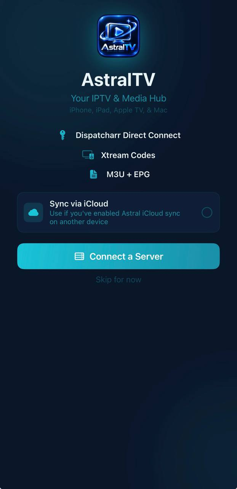
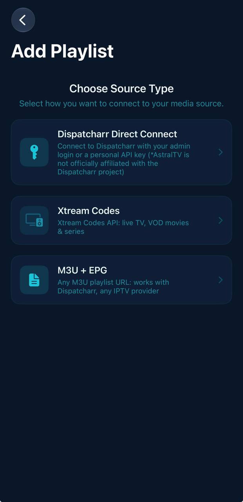
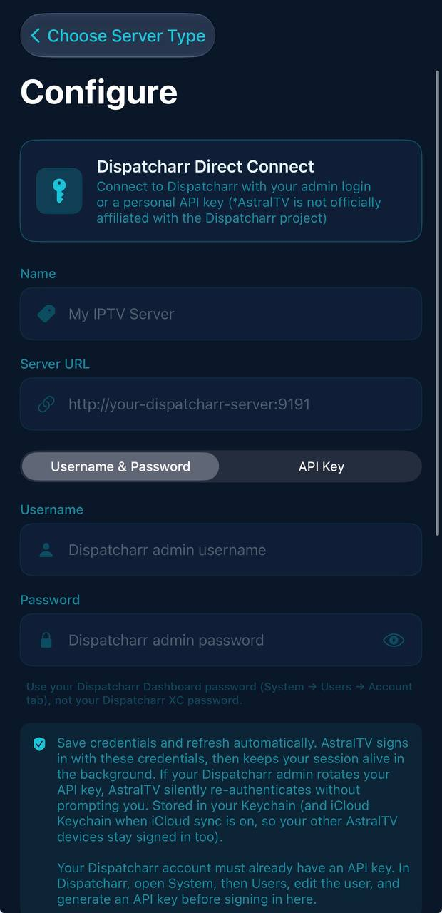
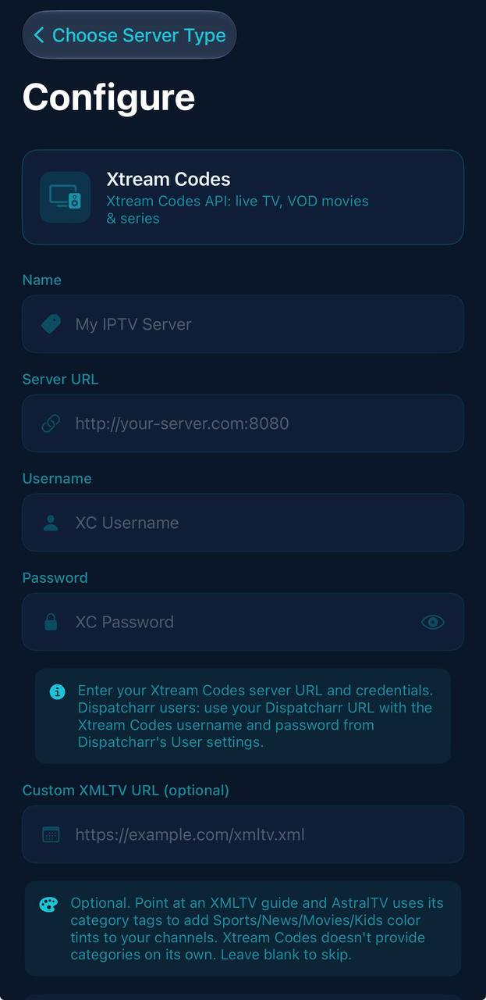
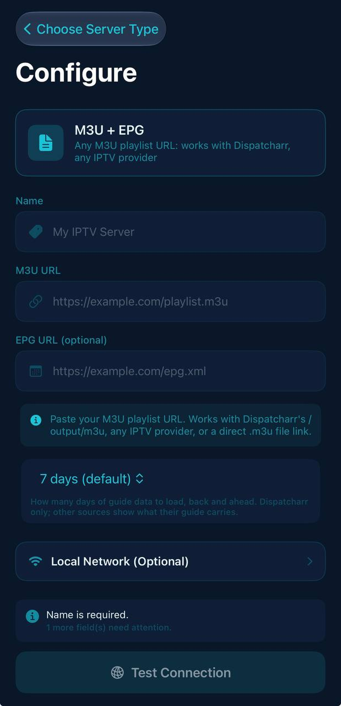

  

# AstralTV

AstralTV is an IPTV player for iPhone. It plays live channels, an electronic program guide, recordings, and on-demand movies and series from media sources you provide.

## Screenshots

  
  
  
   
  
  

## Features

- **Live TV** with a program guide (EPG), channel groups, and a switch-stream view.
- **Recordings (DVR)** for scheduled and manual recordings.
- **Movies and series** with detail pages, search, and resume.
- **Multiview** to watch several channels at once.
- **Google Cast and AirPlay** to send playback to other screens.
- **CarPlay** support.
- **Subtitles and HDR playback** through the mpv media engine.

## Supported sources

AstralTV connects to media sources you supply:

- Dispatcharr servers
- Xtream Codes portals
- M3U playlists with XMLTV guide data

AstralTV does not provide any content or subscriptions.

## Requirements

- An iPhone running iOS 18.0 or later
- [Feather](https://github.com/claration/Feather) installed on the iPhone (an on-device IPA signer)
- A signing certificate (`.p12` file and its password) and, for the Apple Developer route, a matching provisioning profile (`.mobileprovision`). See step 1 below.

## Installation

The steps below run entirely on the iPhone. Feather needs signing material, and getting it usually requires a Mac or a signing service, so that is covered in step 1.

1. **Get signing material.** Choose one route:
   - **[ArcticSign](https://arcticsign.app/)** (third-party, paid): buy a device certificate, then install Feather from the [ArcticSign tutorial](https://arcticsign.app/tutorial) on the iPhone. ArcticSign says the Feather build it provides has the certificate already set up, and that no computer is needed.
   - **Apple Developer account:** on a Mac, create and export a `.p12` certificate with Keychain Access, then download a `.mobileprovision` profile. See the [Feather account guide](https://github.com/claration/Feather/wiki/Using-an-Apple-Developer-Account).

   Certificates from third-party sellers are not issued by Apple, and Apple can revoke them at any time. If a certificate is revoked, apps signed with it stop working. Keep your `.p12` file and its password private.
2. **Install Feather** (Apple Developer route only; the ArcticSign tutorial covers its own Feather install) from its official [GitHub releases](https://github.com/claration/Feather/releases). Follow the install instructions in the [Feather wiki](https://github.com/claration/Feather/wiki) for your iOS version.
3. **Get the app.** In Safari on the iPhone, download `AstralTV.ipa` from the [Releases page](https://github.com/CRZX1337/AstralTV/releases) and open it with Feather.
4. **Import your signing material** (Apple Developer route only) in Feather's signing settings: the `.p12` file, its password, and the `.mobileprovision` file.
5. **Sign and install.** Choose Sign & Install in Feather.
6. If iOS asks you to trust the developer, open **Settings > General > VPN & Device Management**, select the profile, and trust it. Then open AstralTV.
7. If iOS asks for it, turn on **Settings > Privacy & Security > Developer Mode** and restart the phone.

Profiles from a free Apple ID expire after 7 days. Sign and install the app again with Feather when that happens.

## License

AstralTV is free software, licensed under the [GNU General Public License v3.0 or later](LICENSE). It includes an additional permission under GPL section 7 for linking the proprietary Google Cast SDK; see [LICENSE-EXCEPTIONS.md](LICENSE-EXCEPTIONS.md).

Releases published before the relicense were distributed under the MIT License. That grant is not revoked for those releases.

Third-party components keep their own licenses. See [THIRD_PARTY_LICENSES.md](THIRD_PARTY_LICENSES.md).

## Patents and codecs

AstralTV is free software under GPL-3.0-or-later and grants no patent license. AstralTV does not bundle a third-party video encoder. Video encoding for casting uses the codecs provided by the operating system. Users are responsible for complying with any patent or licensing requirements where they live.

## Contributing and issues

Please report bugs and request features at [github.com/CRZX1337/AstralTV/issues](https://github.com/CRZX1337/AstralTV/issues).
